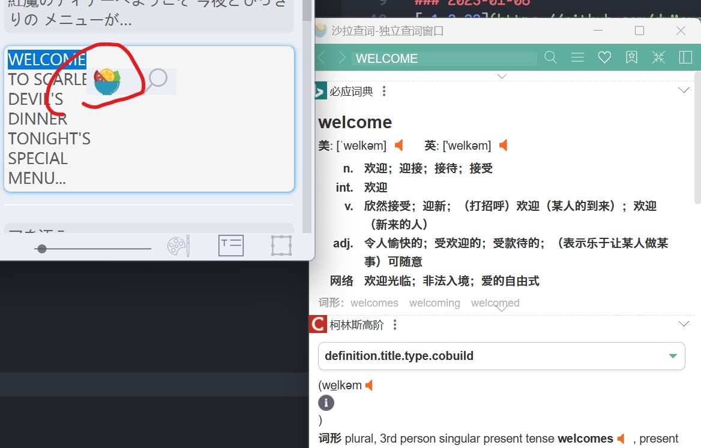
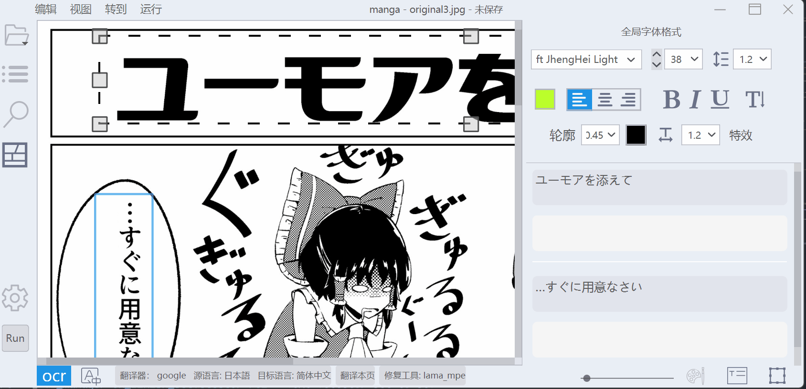
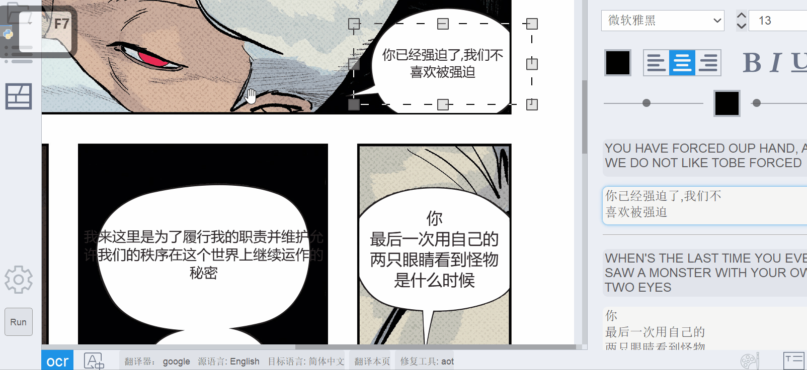

# Changelogs

### 2026-11-10 — 1.5.19+vibe.72
- 更新检查、版本链接、缓存的版本元数据、源码下载和应用内版本提示现在均指向 `CoSciBlog/BallonsTranslator-vibe` 分支，而不是上游项目。分支尚未发布版本时会正常显示“暂无版本”，缓存的上游版本元数据会被拒绝。
- 当保存后的自定义 LLM 配置数量减少时，会先将旧配置复制到 `config/llm_profile_backups`，以便恢复意外删除的配置。

### 2026-11-10 — 1.5.19+vibe.71
- 将浮动的基准测试选择器替换为专用的 **Benchmark Results** 左侧按钮和侧边栏。侧边栏列出每个已完成的 LLM 配置及模型，点击即可切换当前页面的只读实时译文；切换页面时会保留所选模型，也可返回可编辑的项目译文而不丢弃基准测试报告。

### 2026-11-09 — 1.5.19+vibe.70
- 完成的基准测试结果现在可通过紧凑的配置选择器继续显示在主编辑器中。切换配置或项目页面时只会替换独立的只读文字叠加层；关闭预览即可恢复可编辑的项目译文，不会更改项目数据或撤销历史。

### 2026-11-09 — 1.5.19+vibe.69
- 翻译基准测试现在会在每个配置完成后立即提供只读的**页面预览**。可直接切换页面和 LLM 配置进行视觉比较，使用已有的修复图（若有）或原图作为背景，而不会修改打开的项目、撤销历史、词汇表或翻译历史。
- 每次基准测试保存在独立的时间戳文件夹中：`benchmark.json` 记录共享元数据，每个 LLM 配置的完整结果及冻结文本框几何保存在单独的 JSON 文件中。整个文件夹会一次性发布，旧结果不会被覆盖；手动合并 JSON/CSV 导出仍可使用。

### 2026-11-02 — 1.5.19+vibe.68
- 每次完成或部分取消的翻译基准测试现在都会以带时间戳的独立 JSON 报告原子保存到项目文件夹中。已有报告不会被覆盖，结果对话框会显示保存路径，同时保留手动 JSON/CSV 导出功能。

### 2026-11-02 — 1.5.19+vibe.67
- 新增 **工具 → 翻译基准测试...**（`Ctrl+Shift+K`）。所选页面的文本检测和 OCR 只运行一次，随后两个或更多支持文本的 LLM 配置会在同一份冻结 OCR 结果的独立副本上依次翻译。对话框并排显示每个配置的结果、耗时和错误，并可导出不含 API 密钥的 JSON/CSV。基准测试不会修改当前项目的文本、译文、术语表或翻译历史；复制 LLM 配置即可复现并比较不同模型、提示词、采样、审校和相邻页面上下文设置。

### 2026-11-02 — 1.5.19+vibe.66
- LLM 翻译会在一个结构化请求中共同处理当前页面的所有非空文本区域。每个文本配置中新增默认关闭的 **Use previous and next page as context**；启用后，紧邻的上一页和下一页原文会作为只读故事上下文发送，以改善连续性和指代判断。相邻页面文本不会被翻译、写入当前页面或加入可复用历史；上下文恢复时会优先移除这些可选文本。

### 2026-10-27 — 1.5.19+vibe.64
- 流水线进度现在使用带可拖动标题栏的独立原生窗口。处理期间仍会防止意外关闭；如需安全取消，请使用窗口中的“停止”按钮。

### 2026-10-27 — 1.5.19+vibe.63
- 批处理现在会在每个已完成项目后清除可复用的 LLM 上下文，并在启用“恢复”时静默跳过已全部完成的任务。若翻译因输出上限而中断，会仅携带当前输入和词汇表重试一次；所有项目结束后仍只显示一次最终完成消息。

### 2026-10-27 — 1.5.19+vibe.62
- 批处理现在允许仅启用图像放大。仅放大的计划不会创建空的流水线任务，因此整个批处理期间文本检测、OCR、修复、重新修复和翻译都会保持禁用。

### 2026-10-26 — 1.5.19+vibe.61
- 在批处理窗口中新增按上下文显示的 LLM 配置选择器。LLM 翻译器可选择支持文本的配置；所选配置会用于并记录到每个项目，更换配置会创建不同的恢复计划，批处理结束后会恢复之前的全局选择。

### 2026-10-26 — 1.5.19+vibe.60
- 优化了流水线历史表格的初始列宽，并支持使用鼠标自由调整所有列的宽度。刷新历史记录时会保留手动调整后的列宽。

### 2026-10-26 — 1.5.19+vibe.59
- 简化工具菜单，仅保留直接显示的 **Upscale Entire Project 2x...** 操作。移除了 Upscaling 子菜单及当前页面放大操作，同时保留项目和批量放大功能。

### 2026-10-26 — 1.5.19+vibe.58
- 在每个 LLM 配置的文本设置中新增默认关闭的 **Review and optimize translation with LLM**。启用后，每页初译会接受第二次 LLM 审校；审校会结合原文、页面上下文、词汇表、记忆和可用图像，改善自然表达、准确性、代词、说话者/听者指代、性别措辞及正式程度。只有审校后的译文会进入页面历史；每页会增加一次 LLM 请求。

### 2026-10-26 — 1.5.19+vibe.57
- 单项目处理继续逐页保存完成状态，可通过 **Continue** 从出错页面继续。批量处理新增默认启用的 **Resume** 选项：现有项目中已完成的页面会立即复用，而匹配的已完成项目阶段和预放大任务则从批量根目录中的原子检查点恢复。整个批量成功后会自动删除检查点；关闭 Resume 可重新处理全部内容。

### 2026-10-26 — 1.5.19+vibe.56
- 可选的批量预放大现在会先完成所有已选项目文件夹，然后才在任何项目中开始文字检测、OCR、修复或翻译。选定的“按项目完成”或“分阶段”顺序会在这个公共前置步骤之后生效，已忽略页面仍只参与放大。

### 2026-10-19 — 1.5.19+vibe.55
- 新增 **Settings → General → Application → Page thumbnail size**，可选 32、48（默认）、64、96 和 128 px。尺寸设置会保存并立即生效，保留页面选择和忽略状态，在后台重新加载预览并丢弃过期结果。无效的已保存尺寸会发出警告并恢复为 48 px。

### 2026-10-19 — 1.5.19+vibe.54
- 图像放大成功后不再弹出提示；放大或应用结果时发生错误仍会显示错误消息。

### 2026-10-18 — 1.5.19+vibe.53
- 恢复了含 100 页及以上项目的侧栏页面缩略图。通过 **Settings → General → Application → Show page thumbnails** 可即时显示或隐藏缩略图并记住选择；旧配置默认启用。
- 缩略图在后台逐张解码为小图，切换项目、禁用预览或销毁列表时取消过期任务，延迟结果不会覆盖新项目的缩略图。损坏的预览不影响页面使用，切换时保留当前页面与忽略状态。补充了英语、德语界面文本及各语言 README 说明。

### 2026-10-18 — 1.5.19+vibe.52
- 在页面右键菜单中新增 **Reset page data...**。确认后仅清除所点击页面的文本框、OCR、译文、蒙版、修复、绘图、生成结果及处理进度，保留原图、页面顺序和流水线忽略状态。
- 将原项目快照和生成文件保存在独立的 `.page_reset_backup_*` 文件夹中；文件或保存失败时恢复原数据。处理或保存进行中时禁止重置，磁盘操作在工作线程中运行。重置当前页面也会清空画布及撤销历史。附带英语和德语界面文本。

### 2026-10-18 — 1.5.19+vibe.51
- 将循环切换的 `Aa` 按钮替换为带标签的大小写选择框，可直接选择正常、大写或小写。已有保存格式、混合选择和撤销功能保持兼容，原文和译文字符串不会被修改。
- 补全了全部九种界面语言中的选择框标签和工具提示。

### 2026-10-18 — 1.5.19+vibe.50
- 为文本格式面板补充英语和德语工具提示，涵盖工具栏图标、分区控件、Ruby/振假名、连字、效果选项、橡皮擦设置以及效果和变换的数值控件。变换快捷键提示与编辑操作说明一并保留。

### 2026-10-18 — 1.5.19+vibe.49
- 批量预放大现在也处理已忽略的页面，即使项目中的所有页面都被忽略。文字检测、OCR、修复和翻译仍会跳过这些页面，放大后的文件重命名也会保留其忽略状态。

### 2026-10-16 — 1.5.19+vibe.48
- 即使关闭流水线后的自动合并，后合并的几何设置仍可编辑，以便独立配置手动合并。
- 所选文本框合并现在使用 1.4-vibe 区域合并工具的可配置方向、间距、重叠和标签规则，不再将连通的选择强制合并成一个框。相邻组分别合并，孤立框保持不变，一次撤销即可恢复所有原始项目和选择。
- 当前页面、流水线后处理及全项目区域合并在两个方向的处理过程中保留原始组成员。首轮扩大的矩形不会连接无关区域；即使重叠阈值为 0%，也仍需空间对齐。

### 2026-10-16 — 1.5.19+vibe.47
- 恢复 1.4-vibe 的蒙版扩张和残留文字检测功能。“运行 → 修复”现在提供椭圆扩张半径和可选蒙版优化，适用于当前页面、所选页面、所有页面及批量重新修复。
- 在本次生成的结果上额外修复检测到的残留文字，并将其加入完整的已保存蒙版，保留 OCR、翻译及文本框外的手动蒙版像素。每次运行均从原始页面开始。推理成功后保存扩张或合并的蒙版；取消操作或推理失败时保留原有文件。旧配置默认不扩张、不检测残留文字。

### 2026-10-14 — 1.5.19+vibe.46
- 将批处理的父文件夹输入框扩展至整个对话框宽度，并支持键入、粘贴和清除路径。文件夹选择按钮保留在输入框下方；支持带引号的 Windows 路径，修改路径后会在验证前丢弃之前找到的项目文件夹列表。

### 2026-10-13 — 1.5.19+vibe.45
- 修复批处理在预放大重命名原始图像后因 `ImgnameNotInProjectException` 崩溃的问题。流水线启动前，页面列表和画布现在会重新加载已保存的项目，保留当前页面，并在后续页面切换时使用更新后的文件名。

### 2026-10-12 — 1.5.19+vibe.44
- “当前页面/所有页面重新修复”现在会处理已保存蒙版中的每个像素，包括 OCR 文本框裁剪范围之外的遗漏字形边缘和手动扩展区域。
- 重新修复仍从原始页面开始，不会叠加旧的修复结果。

### 2026-10-12 — 1.5.19+vibe.43
- 修复自动排版文本框在 Qt 最终渲染高度大于初步气泡矩形时裁掉后续文本行的问题。气泡区域仍作为首选换行边界，最终文本框会扩展到完整渲染内容，并在尺寸允许时保持在页面内。

### 2026-10-12 — 1.5.19+vibe.42
- 将自动合并和当前页面合并控件从“设置 → 排版”移至独立的“设置 → 合并后处理”页面，所有合并行为和已保存设置保持不变。

### 2026-10-12 — 1.5.19+vibe.41
- 在“设置 → 排版”中恢复 1.4-vibe 的“将自动排版文本框限制在对话气泡内”和“自动排版但不保存换行符”选项，并适配当前文本几何引擎。
- 自动排版生成的文本框现在始终位于页面内，可限制在检测到的对话气泡区域中，并能保留视觉换行而不保存自动生成的硬换行；现有字母大小写控件继续提供所需的大写模式。

### 2026-10-12 — 1.5.19+vibe.40
- 自动合并和当前页面合并现在只形成有界的局部分组，不再通过一串彼此相邻的文本框把整页合并在一起。
- 方向、最大间距、重叠比例和标签规则继续兼容 1.4-vibe 的合并行为；现在结果分组中的每一对文本框都必须满足这些规则。

### 2026-10-12 — 1.5.19+vibe.39
- “分离重叠文本框”现在会为所有选中文本框共同寻找页面内的位置；必要时也会移动第一个文本框，不再因先固定它而留下本可避免的重叠。
- 新布局继续与未选中的文本框保持 8 px 间距，并保留原有的撤销行为和页面边界保护。

### 2026-10-12 — 1.5.19+vibe.38
- “设置 → 排版”中的文本框合并方向选择器现在显示在说明文字下方，不再超出窗口右侧。

### 2026-10-12 — 1.5.19+vibe.37
- 主窗口现在会恢复上次关闭时的普通窗口大小、屏幕位置和最大化状态，不再始终以最大化方式启动。
- 如果保存的位置属于已断开的显示器，窗口会安全地移到当前主显示器上。

### 2026-10-11 — 1.5.19+vibe.36
- 画布右键菜单新增合并选中文本框，快捷键为 Ctrl+Alt+M；新增可撤销的文本框分离操作，在页面内保留 8 px 间距。
- 启用移除翻译换行后，自动排版不再重新保存硬换行；文本仍按文本框宽度显示换行。
- 运行对话框新增“仅重新修复”选项，可使用已保存蒙版重新执行修复；同时新增在成功完成流水线后合并兼容相邻文本框的开关。
- 翻译设置新增可见的“项目术语表”选项，明确 OCR 字母大小写处理范围，并为运行流程补全说明性工具提示。
- 切换项目时页面范围现在会重置为全部页面；为同一项目重新打开运行对话框时仍会保留当前范围。

### 2026-10-11 — 1.5.19+vibe.35
- 侧边栏文本框合并现在只接受由相邻区域组成的连通组，并使用随文本框尺寸缩放的距离阈值，防止误合并不同气泡中的文本。
- 合并区域现在使用画布上可见逻辑框的并集，而不是过期的 OCR 多边形；画布位置和项目中保存的几何信息在撤销/重做时保持一致。
- 每个原始文本框的源文本和译文之间现在会插入一个空行。

### 2026-10-11 — 1.5.19+vibe.34
- 文本 LLM 配置新增按配置保存的“先使用 Google 翻译”选项，并提供源语言自动检测、请求延迟和 LLM 失败时保留 Google 草稿的设置。
- 项目翻译现在会先完成并保存所有页面的 Google 草稿，然后才开始任何 LLM 润色；选区翻译也会在单次请求内使用相同的两步流程。
- 从 LLM 配置中移除 Ollama 内存估算卡片及相关估算代码。
- 扩展 Manga OCR、Hayai OCR、PaddleOCR-VL Manga、PP-OCRv6 等 OCR 模块的生成长度、输入尺寸、置信度和批量设置，并补充完整的本地化参数说明。
- 扩展本地修复模块，新增 OpenCV 方法/半径、PatchMatch 补丁尺寸、最高 2560 px 的神经网络模型分辨率、FLUX 推理步数及完整参数说明。

### 2026-10-11 — 1.5.19+vibe.33
- ComicTextDetector 的检测尺寸选择器新增兼容模型步幅的 GPU 分辨率，最高可达 2496 px，包括 1536、1920、2048、2304 和 2432 px。
- 为检测分辨率、分块批量、设备行为、字体大小控制和蒙版扩张补充完整的本地化标签与说明，并注明性能、显存影响以及 CPU/ONNX 固定使用 1024 px 的限制。
- 修复已加载模型的检测尺寸实时更新，并将“最大分块批量”真正传递给 CTD 运行时；此前该设置只会显示和保存，不会应用到模型。

### 2026-10-11 — 1.5.19+vibe.32
- 页脚中的齿轮按钮现在会直接打开文本检测、OCR、修复或翻译器对应的完整设置页面，不再显示紧凑的模块参数弹窗。
- 模块下拉选择和相邻的 LLM 配置编辑操作保持原有行为。
- 新增回归测试，验证每个页脚齿轮操作都会选择正确的设置页面。

### 2026-10-11 — 1.5.19+vibe.31
- 左侧边栏新增当前页面重新修复、打开术语表管理器和打开流水线历史记录的快捷按钮。
- 快捷按钮复用现有工具菜单流程，包括项目验证、忙碌状态保护、待处理编辑保存、流水线历史记录和缓存管理窗口。
- 为三个操作新增主题感知 SVG 图标、本地化标签和工具提示、无障碍名称以及信号级界面回归测试。

### 2026-10-11 — 1.5.19+vibe.30
- 左侧边栏新增 **合并所选文本框** 按钮，可按页面顺序将两个或更多所选区域合并为一个边界框。
- 原文和译文会在每个原始文本框之间加入一个明确的换行符，并安全清除与旧几何区域绑定的富文本和蒙版。
- 侧边栏合并作为单个文本历史操作执行，完整支持撤销/重做、选择恢复、成对编辑器同步和搜索结果刷新。

### 2026-10-11 — 1.5.19+vibe.29
- 在 **文本变换** 中新增紧凑的 `Aa` 控件，可让所选文本框和全局样式在正常、小写和大写显示模式之间循环切换。
- 大小写作为可持久化且非破坏性的字体样式保存：原文和译文内容保持不变，可显示混合选择状态，并接入现有文本格式撤销流程。
- 无界面模式和项目级样式应用现在也会保留所选大小写模式。

### 2026-10-11 — 1.5.19+vibe.28
- 项目使用 **Two-Step (Google/DeepL + Ollama)** 运行时现在严格分为两个阶段：Google 或 DeepL 会先完成所有选中页面，然后才会发出第一个 Ollama 润色请求。
- 第一阶段的完整结果会在 Ollama 启动前保存为可恢复的项目检查点；如果检查点保存失败，流程会停止且不会启动润色。
- 手动翻译所选文本框时仍保留即时双步骤行为，因为该操作没有项目级页面集合。

### 2026-10-11 — 1.5.19+vibe.27
- 新增 **工具 → 将当前文本样式应用到所有页面...**，可使用当前显示的全局字体格式替换项目内所有文本框的格式，包括类型化文本效果和文本变换。
- 经确认的项目级更新会保留原文、译文、文本框几何、蒙版和图像，仅替换逐字符富文本样式覆盖。
- 更新成功后会创建项目备份、立即重建当前页面，并重置仍引用旧样式的撤销历史。

### 2026-10-11 — 1.5.19+vibe.26
- 在 **设置 → 排版** 中新增 **移除现有换行符...**，使已有项目译文也能像新的流水线输出一样进行换行清理。
- 明确确认后的项目级清理会移除可能恢复旧硬换行的富文本段落，保存项目备份，并在成功保存后重置过期的撤销历史。
- 从字体工具栏移除重复的描边颜色选择器；描边颜色仍可在完整的 **文本效果** 控件中设置。

### 2026-10-11 — 1.5.19+vibe.25
- 修复术语表提取仅因译文包含标点或超过五个单词就丢弃对应译文的问题。
- 自动确认现在会把没有目标译文的候选项保留为建议；后续成功翻译可安全补全仍为空的已确认 OCR 条目。
- 术语表管理器新增 **补全缺失翻译**，可从项目中明确匹配的已翻译文本框恢复空条目，并跳过冲突、受保护条目、已拒绝建议和已有译文。

### 2026-10-11 — 1.5.19+vibe.24
- 为每个本地 LLM 配置新增非阻塞的 Ollama Reasoning 能力检测；**检测**会读取所选模型的 `/api/show` 元数据并显示服务端报告的默认值。
- Thinking Level 现在只提供该模型明确声明的控制项，包括布尔 Enabled/Disabled 或模型自定义等级；不支持 Reasoning 的模型固定为 Disabled，缺少元数据时则安全使用 Auto。
- 检测结果按模型持久保存，即使上下文长度使用服务器默认值，也会通过 Ollama 原生聊天接口应用；更换模型或端点会使旧检测结果失效。

### 2026-10-11 — 1.5.19+vibe.23
- 修复 Windows 下文本样式预设右键菜单未继承应用主题的问题，该无边框弹出菜单此前可能透明地叠在格式控件上。
- 弹出菜单现在归属于预设面板，因此在浅色和深色主题下都会保留配置的不透明菜单背景。

### 2026-10-11 — 1.5.19+vibe.22
- 新增 **Two-Step (Google/DeepL + Ollama)** 翻译流程：先由 Google Translate、DeepL Free 或 DeepL Pro 生成初稿，再由所选本地 Ollama 文本配置结合现有上下文、术语表、重试和结构化响应流程进行校对与润色。
- 在 **设置 → 模块 → 翻译器** 中新增独立设置页，可选择第一步服务、填写 DeepL 密钥、配置请求延迟，并决定 Ollama 润色失败时是否保留机器翻译初稿。
- 双步骤翻译器会保留 Ollama 配置选择并过滤不兼容的远程配置；现有 **google** 翻译器仍可直接进行不经过 LLM 的 Google 翻译。

### 2026-10-11 — 1.5.19+vibe.21
- 将 Ollama 内存估算重新设计为紧凑的主题信息卡，并放置在相关配置附近，避免原先位于提示词编辑器下方的长文本被裁切。
- GiB 估算范围、当前上下文长度、近似值标记、默认状态和不可用状态现在分开展示，详细限制仍可通过工具提示查看。

### 2026-10-11 — 1.5.19+vibe.20
- 在 **设置 → 排版** 中新增可选的相邻文本框合并功能，提供方向、间距、重叠阈值设置以及立即处理当前页面的操作。
- 成功完成流程后可仅合并本次处理的页面；被忽略或未选择的页面保持不变，现有高级区域合并工具仍支持标签规则和整个项目处理。
- 统一了共享合并流程；合并区域时会保留 OCR 原文和翻译，同时丢弃在几何范围变化后已失效的富文本和区域蒙版。

### 2026-10-11 — 1.5.19+vibe.19
- 在主文本格式工具栏的字体颜色控件旁新增紧凑的描边颜色选择器，并补充英语/德语提示和无障碍文本。
- 描边颜色修改使用现有类型化效果栈，在一次可撤销操作中保留宽度、位置、不透明度、混合方式、其他效果、全局样式和多选行为。
- 对没有描边的文本选择描边颜色时会明确添加标准描边效果；效果卡修改以及撤销/重做也会同步更新紧凑颜色选择器。

### 2026-10-11 — 1.5.19+vibe.18
- 在 **设置 → 排版** 中新增可选的 **移除翻译换行符** 设置；新翻译可以去除模型生成的硬换行，并交由现有文本框布局自动换行。
- 换行移除在繁简转换、关键词替换和字母大小写处理之后执行；非 CJK 文本以一个空格连接，CJK 文本则不插入人为间距。
- 旧项目默认保持原有行为；仅切换该设置不会改写已有翻译或手动编辑的文本。

### 2026-10-11 — 1.5.19+vibe.17
- 使用完整英文文档替换仓库的中文主 README，使 GitHub 和软件包的默认项目页面改为英文。
- 更新两个英文 README 的语言导航，避免将英文主 README 错误标记为中文翻译。

### 2026-10-11 — 1.5.19+vibe.16
- 运行对话框新增持久化的翻译失败策略：**重试一次**、**跳过页面**和**中止流程**；默认行为仍为跳过页面。
- 修复图像修复 CPU 回退错误，使其正确抛出 `NotImplementedError`；支持带进度提示地解压 `.001`/`.002` 分卷下载，并让旧 MIT48px 波束入口复用张量化解码缓存。
- OpenAI Responses 传输方式现在可配置，便于 Windows 下进行确定性测试；同时移除依赖受限临时文件的测试写法，并保留前两个版本完成的快速运行和 Ollama 上下文/RAM 控件。

### 2026-10-10 — 1.5.19+vibe.15
- LLM 配置新增本地 Ollama 上下文长度；显式值通过原生 `/api/chat` 的 `options.num_ctx` 应用于翻译与视觉 OCR，`0` 保留 Ollama 默认行为。
- Ollama 配置会根据模型名中的参数量、量化和上下文长度显示清楚标注的 RAM/VRAM 总需求估算范围，无需加载模型或访问网络。
- 支持标准 `:11434/v1`、远程 `:11434` 和原生 `/api/chat` 地址，并保留 JSON Schema、视觉输入、推理控制和令牌统计。

### 2026-10-10 — 1.5.19+vibe.14
- 在侧边栏新增独立的快速运行按钮（`Ctrl+F5`），无需打开运行对话框即可使用当前保存的模块、语言、术语表和处理设置直接启动流程。
- 运行对话框中最后使用的页面范围现在会持久保存并供快速运行复用；当下一个项目页面较少时会安全限制到有效范围。
- 原有 `F5` 按钮保持不变，仍会打开完整运行对话框；新操作使用带闪电标记的独立图标，并提供英语/德语辅助文本。

### 2026-10-10 — 1.5.19+vibe.13
- 放大后的源图像现在会在文件名中记录实际倍率，例如 `001.png` → `001_x2.png`；再次执行 2× 放大会得到 `001_x4.png`。
- 项目页面键、索引、当前页面状态、图像元数据和保留的文本几何信息会随重命名后的图像原子更新；激活或保存失败时会完整回滚。
- 兼容旧版 `_upscaled_2x` 文件名，并提供可复用的整数倍率命名和缩放支持，为后续 x3、x4 及更高倍率流程做好准备。

### 2026-10-10 — 1.5.19+vibe.12
- 新增 **工具 → Pipeline-Verlauf**（`Ctrl+Shift+H`），显示流程开始时间、耗时、状态、阶段、模块和翻译所用的 LLM 配置及模型。
- 普通流程、继续、渲染、重新修复、完整批处理和各批处理阶段现在记录到独立、版本化且原子写入的 `pipeline_history.json`。
- 批处理总记录保存在批处理根目录，各项目阶段同时保存在对应项目目录；损坏的历史文件不会被静默覆盖。

### 2026-10-10 — 1.5.19+vibe.11
- 新增 **工具 → 重新修复当前页面/所有页面**，使用原始页面、已有检测掩膜和文本区域重新运行当前修复器，避免叠加旧修复结果。
- 批处理新增可选重新修复步骤；逐项目模式在正常流程后执行，分阶段模式则保留在本地模型阶段。
- 重新修复沿用流程忽略页面、后台取消、模块延迟加载、项目进度保存以及英语/德语界面。

### 2026-10-10 — 1.5.19+vibe.10
- 新增 **工具 → 批处理**，可依次处理所选目录中直接包含图像的子目录，并选择文本检测、OCR、备用 OCR、图像修复、翻译器、术语表范围及可选的 2× 源图放大。
- 新增逐项目完整执行和分阶段执行。分阶段模式先完成所有项目的检测/OCR/修复，卸载这些模型后再连续翻译所有项目，以便复用已加载的 LLM。
- 新增安全取消、项目/术语表保存、共享批处理 `series_glossary.json`、Windows 完成动作、英语/德语界面文本及规划/回归测试。

### 2026-10-10 — 1.5.19+vibe.9
- 在 **设置 → 模块** 下新增独立的 **文本检测**、**OCR** 和 **图像修复** 页面。它们与流程共享当前模块选择及持久化参数，打开设置本身不会加载模型。
- 将术语表行为设置移至独立的模块设置页面，同时在术语表管理器中保留条目、来源和冲突管理。
- 新增完整复制 LLM 配置、默认自动识别源语言、持久化的逐页流程忽略，以及确认后替换源图像的当前页面/整个项目 2× 放大功能。
- 移除赞助菜单项，并为新设置流程补充英语/德语文本、离屏测试与回归测试。

### 2026-10-10 — 1.5.19+vibe.8
- 在设置窗口的下拉框或数字输入框上滚动鼠标滚轮时，现在会滚动所在设置页面，不再意外改变字段值。
- 修复 `ConfigComboBox` 的滚动目标连接，并在字段拥有键盘焦点时同样使用滚轮透传行为。
- 新增离屏 Qt 回归测试，覆盖已聚焦的下拉框、数字字段、值保持不变以及页面继续滚动。

### 2026-10-10 — 1.5.19+vibe.7
- 新增可选的 **在 LLM 请求前卸载本地模型** 流程设置，可在聊天、Ollama 兼容、Codex 或图像 LLM 请求前释放 BallonsTranslator 的检测、OCR、翻译和修复模型。
- 启用该设置后，LLM 流程阶段使用现有的串行低显存路径，避免卸载并行使用中的本地翻译模型；已释放模块仍会在需要时延迟重新加载。
- 新增经过验证的配置持久化、英语/德语界面文本、请求边界与内存释放测试，并记录外部 Ollama 服务的限制。

### 2026-10-10 — 1.5.19+vibe.6
- 新增第三阶段术语表管理器，支持搜索、增删改查、审核/保护、JSON 交换、来源管理和可见的冲突解决。
- 新增可复用的系列术语表和只读参考术语表，提供确定性优先级、来源追踪、安全持久化，并接入第二阶段的组合提示选择。
- 新增面向未来批处理队列且不依赖 Qt 的项目上下文/完成接口、已验证的术语表设置、英语/德语界面文本、JSON Schema、文档和测试。

### 2026-10-10 — 1.5.19+vibe.5
- 新增第二阶段自动术语候选提取，并提供原子去重、冲突报告、审核状态和可安全中止的翻译流程集成。
- 新增支持 Unicode 与别名的项目术语筛选，在可配置的条目/token 预算内把已确认术语加入 LLM 提示，并提供可选的非破坏性一致性检查。
- 保留外部术语表和所有无术语表翻译路径；不增加额外 LLM 请求或新依赖。

### 2026-10-09 — 1.5.19+vibe.4
- 新增第一阶段项目术语表后端，包含版本化 Unicode 数据模型和不依赖界面的增删改查及搜索服务。
- 新增独立且原子写入的 `glossary.json`、自动保存、外部变更保护、导入导出和 1.4-vibe 术语表迁移。
- 将术语表的创建、加载和关闭接入 v1.5 项目生命周期，且不改变项目 JSON。

### 2026-10-09 — 1.5.19+vibe.3
- 中间项目图像现在支持 JPEG 和 WebP 格式。
- 新增独立的中间图像质量设置，并统一应用于蒙版和修复图像。
- 更改格式后，程序会在 PNG、JPEG、WebP 和 JPEG XL 文件中查找已有的中间图像。

### 2026-10-09 — 1.5.19+vibe.2
- 新增完整的英语和德语界面翻译，并提供可选择的德语语言包。
- 翻译器的源语言和目标语言现在显示本地化名称，同时保留配置文件中的稳定语言标识符。
- 将区域合并工具和模块参数中硬编码的中文界面文本改为可翻译的英文源文本。
- 修复 uv 虚拟环境中的翻译提取，并增加完整性、占位符和语言包运行时测试。

### 2026-10-09 — 1.5.19+vibe.1
- 源码环境迁移为由 uv 管理的项目本地运行时：固定版本的 Python、uv、缓存和依赖均保存在 `.runtime` 与 `.venv` 中，不再使用系统全局 Python。
- 保留已有虚拟环境；环境不完整或 Python 版本不匹配时会停止并显示修复说明，不会自动删除。
- 对不受支持的 Python 版本增加提前报错，避免在 Python 3.13 或更高版本中尝试修复依赖。

### 2023-04-15
支持从某些源站下载/更新图片，感谢[ROKOLYT](https://github.com/ROKOLYT)

### 2023-02-27
[v1.3.34](https://github.com/dmMaze/BallonsTranslator/releases/tag/v1.3.34) 发布
1. 修复繁体直排bug (#96)
2. 彩云和deepl目标语言支持繁体 (#100)
3. 支持读取.webp图片 (#85)

### 2023-02-23
[v1.3.30](https://github.com/dmMaze/BallonsTranslator/releases/tag/v1.3.30) 发布
1. 从PyQt5换到PyQt6以支持更好的嵌字预览, [避免PyQt5与nuitka的线程兼容性问题](https://github.com/Nuitka/Nuitka/issues/251)
2. 支持改变嵌字层透明度 (#88) 注意只是预览, 不会改变渲染结果, 嵌字透明度在右侧菜单效果里改
3. log文件写进data/logs

### 2023-01-27
[v1.3.26](https://github.com/dmMaze/BallonsTranslator/releases/tag/v1.3.26) 发布
1. 选中文本迷你菜单支持*聚合词典专业划词翻译*[沙拉查词](https://saladict.crimx.com): [安装说明](doc/saladict_chs.md)

2. 支持替换OCR和机翻结果中的关键字, 见编辑菜单或设置面板 [#78](https://github.com/dmMaze/BallonsTranslator/issues/78)
3. 支持拖拽导入文件夹 [#77](https://github.com/dmMaze/BallonsTranslator/issues/77)
4. 编辑文本时隐藏控制小方块 [#81](https://github.com/dmMaze/BallonsTranslator/issues/81)
5. 修Bug

### 2023-01-08
[v1.3.22](https://github.com/dmMaze/BallonsTranslator/releases/tag/v1.3.22) 发布
1. 支持删除并恢复被抹除文字
2. 支持角度复位
3. 修Bug

### 2022-12-30
[v1.3.20](https://github.com/dmMaze/BallonsTranslator/releases/tag/v1.3.20)发布
1. 适应具有极端宽高比的图片比如条漫
2. 支持粘贴到多个选中的文本编辑框
3. 修bug
4. OCR/翻译/修复选中文字区域, 填字样式会继承选中的文字框自己的
   单行文本建议选用ctc_48px, 多行日文选mangocr, 目前对多行其它语言不太行, 需要重新训练检测模型  
   注意如果用**ctc_48px**要保证框在竖排模式下且尽可能贴合单行文本

### 2022-11-29
[v1.3.15](https://github.com/dmMaze/BallonsTranslator/releases/tag/v1.3.15)发布
1. 修bug
2. 优化保存逻辑
3. 画笔现在可以改成方形(实验)

### 2022-10-25
[v1.3.14](https://github.com/dmMaze/BallonsTranslator/releases/tag/v1.3.14)发布
1. 修bug

### 2022-09-30
v1.3.13起支持深色模式: 视图->深色模式

### 2022-09-24
[v1.3.12](https://github.com/dmMaze/BallonsTranslator/releases/tag/v1.3.12)发布

1. 支持全局(Ctrl+G)/当前页(Ctrl+F)查找替换
2. 原来的文本编辑器局部撤销重做并入全局文本编辑撤销重做栈, 画板撤销重做现在和文本编辑分离
3. Word文档导入导出bug修复
4. 基于 https://github.com/zhiyiYo/PyQt-Frameless-Window 重写无边框窗口

### 2022-09-13
[v1.3.8](https://github.com/dmMaze/BallonsTranslator/releases/tag/v1.3.8)发布

1. 画笔工具修复及优化
2. 修正界面缩放
3. 支持添加自定义字体样式预设, 支持调整文字透明度和阴影, 详见https://github.com/dmMaze/BallonsTranslator/pull/38
4. 支持导入导出word文档, 支持打开*.json项目文件, 详见https://github.com/dmMaze/BallonsTranslator/pull/40

### 2022-08-31
[v1.3.4](https://github.com/dmMaze/BallonsTranslator/releases/tag/v1.3.4)发布

1. 添加离线日译英模型Sugoi Translator(仅日译英, 作者[mingshiba](https://www.patreon.com/mingshiba), 已获得集成授权), 感谢[@Snowad14](https://github.com/Snowad14)提供CT2转换模型
2. 来自[bropines](https://github.com/bropines)的俄语本地化支持
3. 文本编辑支持字距调节
4. 调整竖排符号及半角字符位置规则, 详见https://github.com/dmMaze/BallonsTranslator/pull/30

### 2022-08-17
[v1.3.0](https://github.com/dmMaze/BallonsTranslator/releases/tag/v1.3.0)发布

1. 修复DeepL翻译器的bug, 感谢[@Snowad14](https://github.com/Snowad14)
2. 修复部分字体偏小+轮廓导致看不清的问题
3. 支持**全局字体格式**(一键机翻字体格式): 在控制面板->嵌字菜单里将相应项从"由程序决定"改为"使用全局设置"后启用. 注意全局设置就是未编辑任何文本块时右侧字体格式面板的那些设置.  
4. 添加**新的修复模型**: lama-mpe (默认启用)
5. 文本块支持多选和**批量调整格式** (ctrl+鼠标左键或者按下右键拉框框选)
6. 支持日译英, 英译中的**自动排版**, 基于提取出的背景气泡, 目标语言为中文时会自动断句(基于pkuseg). 勾选设置面板->常规->嵌字->自动排版后将对一键机翻生效(默认启用). 

批量格式调整, 英译中自动断句分行

### 2022-05-19
[v1.2.0](https://github.com/dmMaze/BallonsTranslator/releases/tag/v1.2.0)发布

1. 支持DeepL翻译器, 感谢[@Snowad14](https://github.com/Snowad14)
2. 增加来自manga-image-translator的新OCR模型, 支持韩语识别
3. 修bug

### 2022-04-17
[v1.1.0](https://github.com/dmMaze/BallonsTranslator/releases/tag/v1.1.0)发布

1. 用qthread存编辑图片, 避免翻页卡顿
2. 图像修复策略优化: 
   - 修复算法和**CPU模式**下的修复模型输入由整张图片改为文本块
   - 可选由程序自动评估当前块是否有必要调用开销大的修复方法, 在设置-图像修复启用/禁用, 启用后纯色背景对话泡将会由计算出的背景色直接填充  
  
    优化后图像修复阶段速度提升至原来的2x-5x不等

3. 添加矩形工具
4. 更多快捷键
5. 修bug

### 2022-04-09
v1.0.0发布
